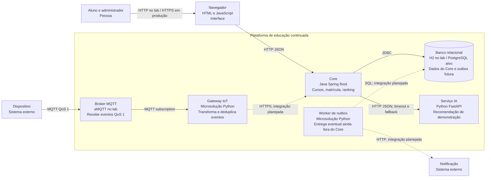
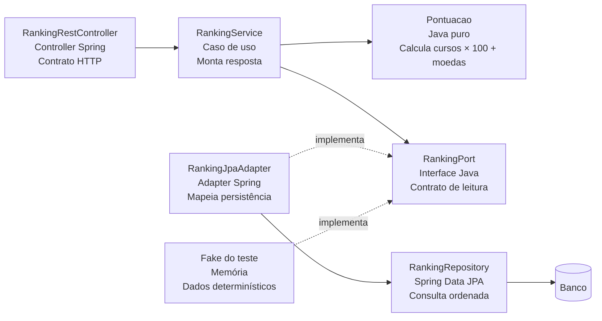
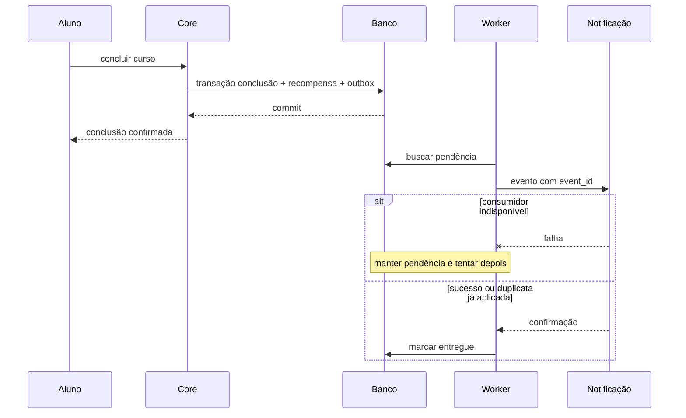

# Visões C4 da plataforma

## Contexto
Aluno e administrador usam a plataforma de educação continuada. Dispositivos de laboratório são sistemas externos que produzem eventos. Provedor de notificação e serviço de IA são integrações com ciclos de falha próprios.

## Container final e estado de implementação

Linhas tracejadas indicam integrações planejadas. O lab de outbox usa seu próprio SQLite; não está ligado ao banco do Core. O gateway demonstra transformação local e não chama ainda o Core. Cada caixa de container identifica responsabilidade e tecnologia; módulos internos não são containers de implantação.

## Component do ranking no Core

## Sequência da conclusão com outbox

## Implantação
Validação executada: Windows com JDK 17 portátil; Core na porta 8084; A3 na 8083; FastAPI na 8001, interrompido no teste de falha; Prometheus na 9093 e Grafana na 3003; broker MQTT temporário na 18883. Cada processo escuta localmente ou é acessado somente para o lab. A implantação proposta usa compose.yml com Core e IA em imagens próprias; Jenkinsfile pressupõe agente Linux. A execução da esteira Jenkins e do Compose ainda precisa ser feita no ambiente da equipe.

## Segurança e operação
O Core de referência usa Basic Auth didático admin/123456. Não representa autenticação multi-instituição. Antes de produção: segredos externos, TLS, autorização por tenant, isolamento dos dados e métricas, ACL MQTT e validação do evento. Não usar IDs de aluno como labels Prometheus. Propriedade dos dados de matrícula e ranking fica no Core; a IA não escreve diretamente no banco do Core.

## ADRs relacionados
ADR-001 define monólito modular; ADR-002 protege regra e porta; ADR-003 separa IA; ADR-004 define outbox; ADR-005 define MQTT/gateway; ADR-006 define pipeline e operação. Diagramas descrevem a decisão alvo e marcam explicitamente o que está apenas demonstrado em microsolução.

## Diagramas renderizados
- [C4 Container](c4-1.png)
- [C4 Component](c4-2.png)
- [C4 Implantação](c4-3.png)

As versões SVG permitem ampliar os diagramas sem perda de qualidade.
