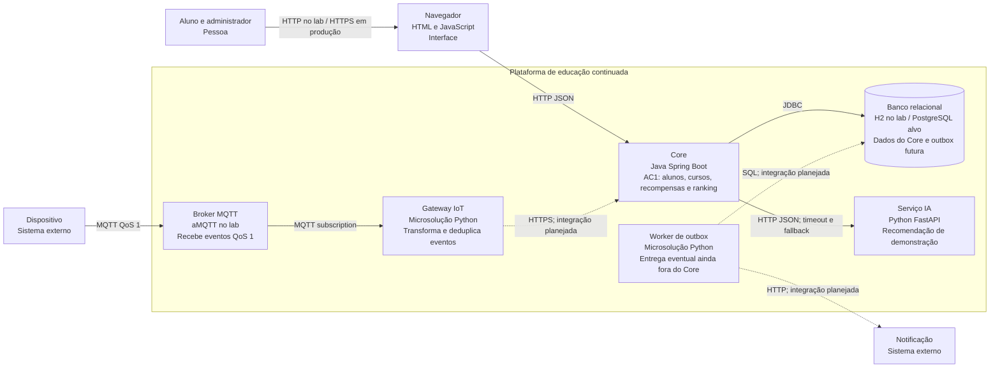
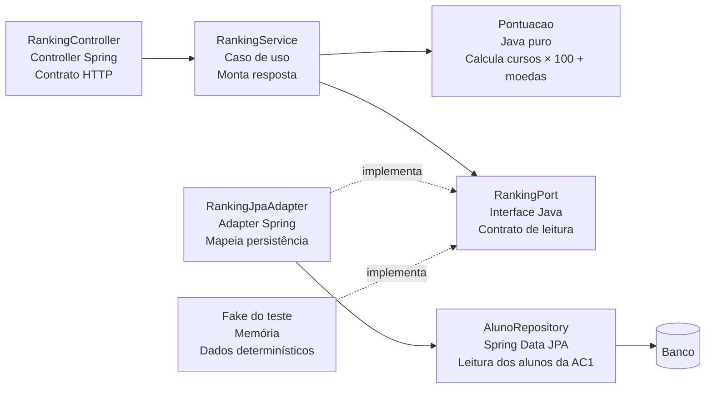
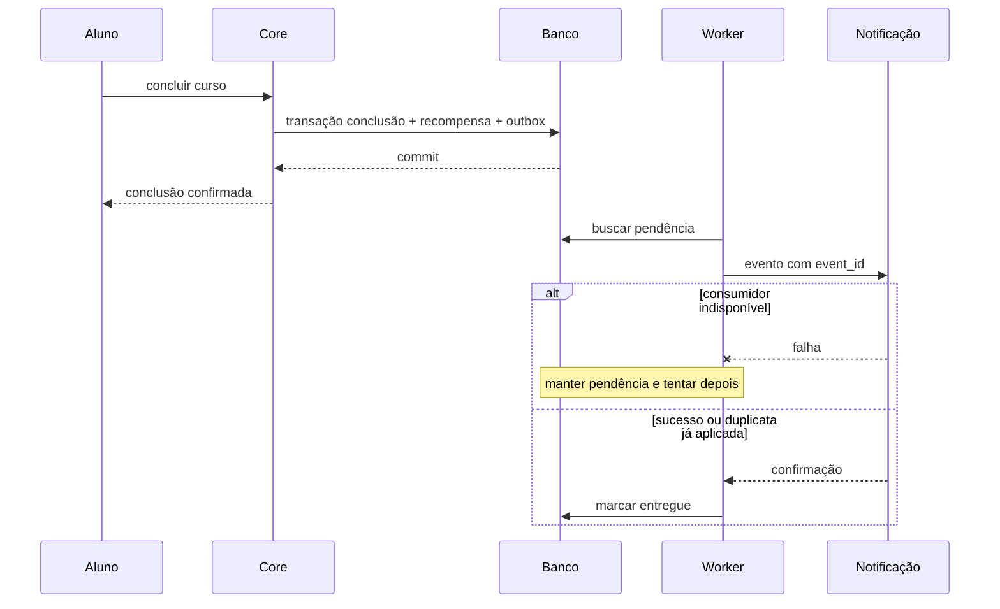
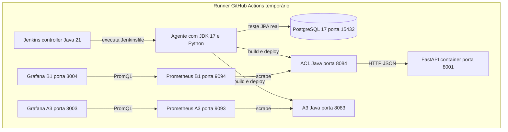

# Visões C4 da plataforma

## Contexto
Aluno e administrador usam a plataforma de educação continuada. Dispositivos de laboratório são sistemas externos que produzem eventos. Provedor de notificação e serviço de IA são integrações com ciclos de falha próprios.

## Container final e estado de implementação

Linhas tracejadas indicam integrações planejadas. O lab de outbox usa seu próprio SQLite; não está ligado ao banco do Core. O gateway demonstra transformação local e não chama ainda o Core. Cada caixa de container identifica responsabilidade e tecnologia; módulos internos não são containers de implantação.

## Component do ranking no Core

## Sequência da conclusão com outbox

## Implantação
O workflow prepara um runner Linux temporário. Jenkins executa o Jenkinsfile obtido do Git, com Java 17 para os projetos e Java 21 no controller. PostgreSQL 17 em container atende ao teste de integração da AC1. Após testes e cobertura, são construídos os containers AC1 e A3, FastAPI e as stacks Prometheus/Grafana. A interrupção do container FastAPI valida o fallback. O resultado efetivo consta no artifact da execução, não é inferido apenas da presença do Jenkinsfile.

## Segurança e operação
Portas publicadas em loopback no laboratório. A AC1 não implementa autenticação multi-instituição; antes de produção serão necessários TLS, autorização e isolamento por instituição. Segredos dos provedores não são versionados. MQTT usa loopback no experimento; ACL/TLS e sessões duráveis ficam para a AF. Não usamos IDs de aluno como labels Prometheus. A IA não escreve no banco do Core.

## ADRs relacionados
ADR-001 define monólito modular; ADR-002 protege regra e porta; ADR-003 separa IA; ADR-004 define outbox; ADR-005 define MQTT/gateway; ADR-006 define pipeline e operação. Diagramas descrevem a decisão alvo e marcam explicitamente o que está apenas demonstrado em microsolução.

## Diagramas renderizados
- [C4 Container](c4-1.png)
- [C4 Component](c4-2.png)
- [C4 Implantação](c4-3.png)

As versões SVG permitem ampliar os diagramas sem perda de qualidade.
